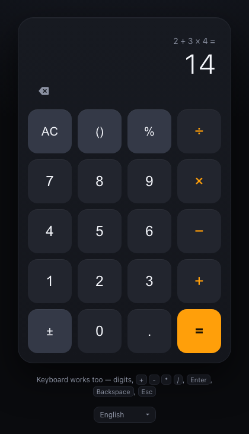
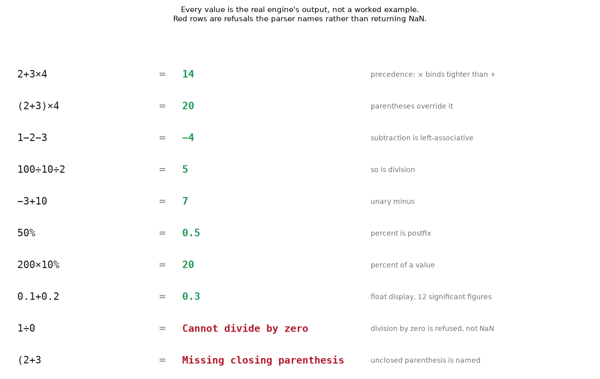
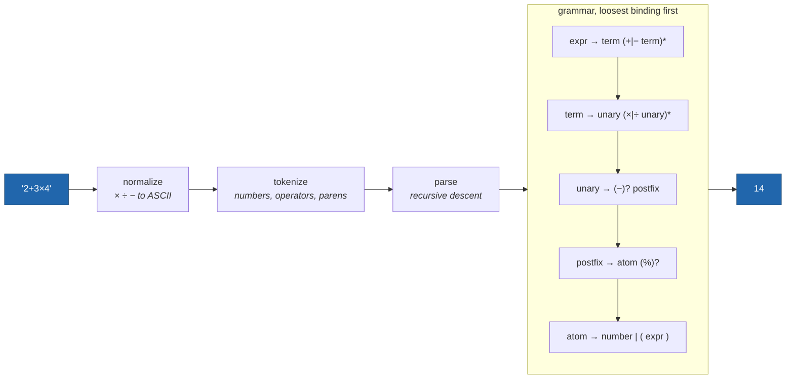

# Calculator, Dark Theme

A dark-theme calculator that runs in the browser. No dependencies, no build step,
just three static files and a `<script>` tag.

**Live demo: https://aghasalim.github.io/calculator-dark-theme/**

<p align="center">
  
</p>

<p align="center"><sub>It gets precedence right, so <code>2 + 3 × 4</code> is 14, not 20.</sub></p>

## Where this came from

This is one of my first projects, something I made as a kid. Back then it lived
on Replit, and this repo never held much more than a link to it, so the code here is a rebuild.

Now I've come back and redone it properly. It has a recursive descent parser, a
dark theme I'd actually ship, keyboard support, tests and a live demo. The idea is
still the one I had as a kid, but all the code is new.

## What the parser actually does



Every value above comes from calling `engine.evaluate`. I regenerate the figure
with `python3 scripts/make_figures.py`, so it can't show something the parser
doesn't do. The two red rows are inputs it refuses with a named error. Neither
returns `NaN`.



Precedence comes from how the grammar is laid out. `expr` calls `term`, so
anything `term` parses binds tighter. That's why `2+3×4` is 14.

## Features

- **Operator precedence and parentheses**: `2 + 3 × 4` is `14`, not `20`. Unclosed
  parentheses are closed for you when you press `=`.
- **Live result preview** under the expression as you type.
- **Full keyboard support**: digits, `+``-``*``/``%``(``)``.`, `Enter` to
  evaluate, `Backspace` to delete, `Esc` to clear, `n` to flip the sign.
- **Readable output**: thousands separators, tabular figures, and a display font
  that shrinks to keep long expressions on one line.
- **Accessible**: real buttons, labelled operators, visible focus rings, results
  announced to screen readers, and animations disabled under
`prefers-reduced-motion`.
- **Sensible errors**: dividing by zero gives an error message.
- **Ten languages**: optional interface translation, pinned and integrity-checked.
  See [Translation](#translation).

## Behaviour worth knowing

Percent is postfix "divide by 100". `50%` is `0.5`, and `200 × 10%` is `20`.
So `200 + 10%` is `200.1`, not `220`. Some phone calculators read `%` as "percent
of the left operand", and this one doesn't. I wanted `%` to mean the same thing
wherever it shows up.

Results carry 12 significant digits. That hides binary float noise, so
`0.1 + 0.2` displays as `0.3`, not `0.30000000000000004`. The downside is that
anything past 12 digits gets rounded, so `123456789 × 987654321` shows as
`121,932,631,113,000,000`. It's a double-precision calculator.

## Layout

| | | | |
|---|---|---|---|
|`AC` |`()` |`%` |`÷` |
|`7` |`8` |`9` |`×` |
|`4` |`5` |`6` |`−` |
|`1` |`2` |`3` |`+` |
|`±` |`0` |`.` |`=` |

`()` is one key: it inserts whichever parenthesis makes sense where you are.

## Files

| File | What it does |
|---|---|
|`engine.js` | Tokenizer, recursive-descent evaluator, number formatting. No DOM. |
|`app.js` | Keypad wiring and input rules, what each key does to the expression. |
|`index.html` /`style.css` | Markup and the dark theme. |
|`test.js` | Self-check for the engine. |

I wrote the recursive-descent parser by hand, so user input never goes to the
JavaScript interpreter.

## Translation

The picker under the keypad switches the interface between ten languages, using
[translate.js](https://github.com/xnx3/translate) (MIT).

It translates the page title, the meta description, the keyboard hint and the
error messages. That's all the text this app has.

It never translates the display, the keypad, or the physical key names in the hint.
Those have `class="ignore"`. I had to do this. The library treats `×` (U+00D7) and
`÷` (U+00F7) as letters, because they fall inside its `[À-ÿ]` range. Without the
fence, bits of your arithmetic would get sent to a translation engine. It also turns
`1e+21` into `1 e +21` even when the translation is the same as the input, which
would break any result big enough to show in exponential notation.

A few choices I made on purpose:

It's pinned, with Subresource Integrity. I load it from a fixed cdnjs version with a
`sha384` hash. The vendor's own URL, `res.zvo.cn/translate/translate.js`, has no
version and gets rewritten in place, so it can't have an `integrity` attribute.

There's no DOM observer. I don't call `translate.listener.start()`. It's meant to
catch text added after load, but every dynamic node here is numeric output that
mustn't be touched. Instead the error strings are put in the page up front and
read back by `app.js`. That way they get translated on load, without an observer
running on every keypress.

It fails safe. If the CDN is down or the hash doesn't match, the script is blocked,
the picker stays hidden, and the calculator works as normal. Translation only ever
adds something.

When you switch language, seven UI strings get sent to `edge.microsoft.com`
(Microsoft Translator). Nothing you type is ever sent, because the display is
excluded before any request. The library also pings `api.translate.zvo.cn` on page
load, even on the `client.edge` channel. A `connect-src` CSP in `index.html` blocks
that, which is why you'll see three CSP errors in the console on load. They're
expected.

If you reuse this, note that `class="notranslate"` and the HTML5 `translate="no"`
attribute do nothing in this library (I checked against the shipped build). Only
`class="ignore"` works, and it applies to the whole subtree.

## Running it

Open `index.html` in a browser, or serve the folder:

```bash
python3 -m http.server 8000
```

## Tests

```bash
node test.js
```

The tests cover precedence, associativity, parentheses, unary signs, percent,
division by zero, bad input and number formatting. There's no test framework. The
checkers in `verify/` also recompute the published values on their own. They all
read one shared set of 52 hand written expressions in `verify/cases.tsv`, and CI
fails the build if any of them disagree.

## Licence

MIT
